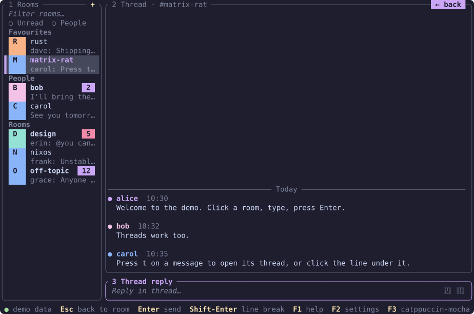

<div align="center">

# 🐀 matrix-rat

**A Matrix client for the terminal that is as comfortable with a rat, ehm, I mean mouse, as with a keyboard.**

[](https://ratatui.rs/)
[](https://matrix.org)
[](https://www.rust-lang.org)
[](LICENSE)


</div>

Rooms on the left, the conversation in the middle, your message at the bottom. Click
anything to focus it, or never leave the keyboard: you start in the composer, `Enter`
sends, `↑` walks into the messages. Encrypted chats, pictures in the terminal, threads,
notifications and themes that follow your desktop are all there.

> **Status: early development.** It is used daily by its author, but it is young. Keep
> another client at hand, and please report what breaks.

## Highlights

| | |
|---|---|
| 🔐 **Private by default** | End-to-end encryption, device verification by emoji comparison, recovery key, and warnings on messages that cannot be fully trusted. See where your account is logged in and sign sessions out, check your key backup, move message keys between devices in a file, and read why a message could not be decrypted. |
| 🖼️ **Pictures in the terminal** | Inline images and a full-window viewer: real graphics in terminals with the kitty graphics protocol, coloured blocks elsewhere. Room pictures in the list (kitty graphics only; coloured initials otherwise). |
| 💬 **Everything a chat needs** | Replies, edits, reactions, threads, mentions, read markers, typing notices; Markdown and `\|\|spoilers\|\|` are applied when you send. |
| 📬 **Pick up where you left off** | A "new" line above the first unread message, with the view starting there when a lot has happened; `Alt-U` jumps back to it. Mark a room as unread to come back to it later (your other clients see that too), or everything as read. |
| 📎 **Files both ways** | Drop a file into the terminal to attach it, `Enter` sends it; `s` on a selected message saves its attachment to your download folder. |
| 🔎 **Find things fast** | `Ctrl-K` for rooms, `Ctrl-F` inside a room, `Ctrl-G` across all rooms (encrypted ones too), `Ctrl-P` for every command. Completions for `@people`, `:emoji:`, `#rooms` and `/commands`. |
| 🖱️ **Mouse-friendly** | Click to focus, scroll anything, drag the divider, right-click for a menu of what applies. |
| 🎨 **Yours to shape** | Eleven built-in themes, dark/light pairing, live theme files for Noctalia, matugen, wallust and pywal, and every key rebindable. |
| 🔔 **Notifications** | Desktop notifications with the chat's picture (click one to open its room), or plain ones through the terminal; none for what you are reading right now. |

## Install

matrix-rat is developed and tested on Linux. The desktop features (notifications with
pictures, following dark/light, the keyring) use D-Bus and are Linux-only; the rest should
build wherever Rust and a terminal are, but that is untested.

**With Nix, from the NUR** (prebuilt, nothing is compiled): matrix-rat is in the
[Nix User Repository](https://nur.nix-community.org) as `nur.repos.tylerstyle.matrix-rat`,
and a binary cache serves it for the `nixos-unstable` and `nixpkgs-unstable` channels.

```nix
# configuration.nix
{ pkgs, ... }:
let
  nur-tylerstyle = import (builtins.fetchTarball
    "https://github.com/tylerstyle/nur-packages/archive/main.tar.gz") { inherit pkgs; };
in {
  nix.settings = {
    extra-substituters = [ "https://tylerstyle.cachix.org" ];
    extra-trusted-public-keys =
      [ "tylerstyle.cachix.org-1:LPNllLpkzqd8U9T9LE7zj7CjXShPpapyTruShQ3V8hw=" ];
  };
  environment.systemPackages = [ nur-tylerstyle.matrix-rat ];
}
```

If you already use the NUR, `pkgs.nur.repos.tylerstyle.matrix-rat` is the same package; pin
the tarball as you pin your other sources. Two things to know: the cache settings must be
active before the package is installed, so on a first setup rebuild once with only the
`nix.settings` lines; and matrix-rat needs Rust 1.96 or newer, so it is not offered for
`nixos-26.05`. If your nixpkgs is older than the cache's, Nix builds it locally instead
(about 20 minutes).

**With Nix, from the source** (the repository is the package; no flake needed):

```sh
git clone https://github.com/tylerstyle/matrix-rat && cd matrix-rat
nix-build                     # ./result/bin/matrix-rat
nix-env -if .                 # or install into your profile
# or on NixOS, in your configuration:
#   environment.systemPackages = [ (pkgs.callPackage /path/to/matrix-rat { }) ];
```
Hype it, like it, use it and when traction hits critical, we'll go to nixpkgs.

**With Cargo** (Rust 1.96 or newer, plus a C compiler, `make`, `cmake` and `perl`):

```sh
git clone https://github.com/tylerstyle/matrix-rat && cd matrix-rat
cargo install --path .        # installs to ~/.cargo/bin
```

**Just try it**, without an account and without installing:

```sh
cargo run -- --demo           # built-in demo data; nothing you change there is saved
```

Any modern terminal works. For real pictures use a terminal with the kitty graphics
protocol, such as [kitty](https://sw.kovidgoyal.net/kitty/) or Ghostty, and run matrix-rat
directly in it: inside tmux, zellij or screen (and in WezTerm and Konsole) pictures are
drawn with coloured blocks instead.

## First steps

You need an existing Matrix account; matrix-rat does not register new ones.

1. **Start it:** `matrix-rat`. Enter your homeserver (for example `matrix.org`), then log in
   with your password, or choose **Log in with browser** for servers with single sign-on.
2. **Unlock your history:** if you use encryption elsewhere, matrix-rat asks for your
   **recovery key** (or recovery passphrase). Entering it also verifies this device. No key
   at hand? Click "⚠ unverified device — verify" in the status line and compare emoji with
   another of your devices.
3. **Chat:** pick a room with the mouse or `Ctrl-K`, type, press `Enter`.

`F1` shows every key, `F2` opens the settings, `Ctrl-P` finds any command by name.

## Everyday keys

| Key | Does |
|---|---|
| `Enter` / `Shift-Enter` | send / line break |
| `↑` from the composer | walk into the messages (from the first line of the composer); then `Enter` reply, `e` edit, `r` react, `t` thread, `p` replied message, `P` pinned messages, `o` open, `v` view picture, `s` save, `c` copy, `d` try decrypting again, `m` menu, `Del` delete, `End` newest |
| `Tab`, `Alt-1`…`3`, `Alt-←↑↓` | move between room list, messages and composer |
| `Ctrl-↑` / `Ctrl-↓` | previous / next room |
| `Alt-U` | jump to the first unread message (the "new" line) |
| `Ctrl-K` · `Ctrl-F` · `Ctrl-G` · `Ctrl-P` | find a room · find in this room · search all rooms · command palette |
| `Ctrl-N` | join a room, start a chat (search people by name or ID), create a room (`info` or `Enter` for User info) |
| `F4` | room details and members (pinned messages, invite, rename, name in room, notifications, favourite, low priority, roles, ban/unban, ignore, leave; `Enter` on a member for User info) |
| `Alt-S` | step through your spaces (header shows unread counts; or pick a space in `Ctrl-P`) |
| `Alt-O` · `Alt-D` | filter the room list to unread rooms · direct chats (`Esc` clears filters) |
| `Alt-E` / `Alt-A` | emoji picker / attach a file |
| `F2` / `F3` | settings / next theme |
| `Ctrl-Q` | quit |

What you type is sent as Markdown: `**bold**`, `*italic*`, `` `code` ``, `||spoiler||`,
`> quote`, lists and links (the composer shows the plain text; the formatting appears in
the sent message). `/me`, `/spoiler`, `/plain`, `/shrug` and friends work as commands;
`@`, `:`, `#` and `/` open completions.

Unsent text stays with its room or thread and is still there after a restart (it is kept
in the encrypted session store). A reply comes back as its text, without what it answered.
To ignore or report someone, use the message menu (`m` or right-click) or Room info (`F4`, `Alt-I`);
you can manage ignored users under **Settings → Ignored users** (`F2`). Where your room
permissions allow, the message menu and Room info also let you pin or delete other members'
messages with a reason, ban or unban users (`Alt-B`), and change roles (`Alt-R`); `P` opens
pinned messages, and `Forward…` copies a message to another room without its reply or thread context.

Click a sender's name or picture, choose **User info** from the message menu (`m` or palette
`Ctrl-P`), press `Enter` on a member in Room info (`F4`), or open a `matrix.to` user link
or user-search result to view their profile, verification state and shared rooms (press
`Enter` to jump to one, `c` to copy their ID), mention them, open a chat, verify or ignore
them, or change their role / remove / ban them in the current room. Open **Settings → Profile**
(`F2`, `Ctrl-P`, or click your name badge on the message box's top border) to update your
display name or avatar picture (`Tab` completes file paths, or drop an image file onto the
window), and use **Name in room…** in Room info (`F4`) to set or clear a per-room display name.

**Sessions and keys** live in the settings (`F2`) and the command palette (`Ctrl-P`):

- **Sessions** lists where your account is logged in, with a warning for every session
  that is not verified. `r` renames one, `v` verifies it by emoji comparison, `Del` signs
  it out (the server asks for your account password; on servers with single sign-on or an
  account service, matrix-rat shows that service's page for it instead), `a` shows the
  addresses the sessions were last seen at.
- **Key backup** says in plain words whether your message keys are backed up on the
  server and whether this device can read the backup; if it cannot, the recovery key can
  be entered from there. `e` exports all message keys of this device to a file protected
  by a passphrase, `i` imports such a file (from matrix-rat or Element); drop the file
  on the window instead of typing its path.
- A message that could not be decrypted says why. `d` (or "Try decrypting again" in its
  menu) looks for its key once more.

<div align="center">

</div>

## Make it yours

Everything is optional. The settings menu (`F2`) covers the common choices and writes
them into `~/.config/matrix-rat/config.toml`, keeping your comments; a few settings
exist only in that file (marked below).

### Themes

Eleven themes are built in; `F3` cycles them. `theme = "terminal"` uses your terminal's own
colours. Switch on **Follow dark/light** in the settings (`theme_dark` and `theme_light`
in the file) to use one theme by day and another by night, following your desktop.

Theme files in `~/.config/matrix-rat/themes/` are reloaded the moment they change, so
wallpaper-driven tools can recolour the app while it runs. Templates for **Noctalia**,
**matugen**, **wallust** and **pywal** are built in:
see [contrib/themes/README.md](contrib/themes/README.md).

<div align="center">

</div>

### Keys

Rebind anything in **Settings → Key bindings**: press `Enter` on an action, then the new
key. Or write it down:

<details>
<summary>Key bindings in <code>config.toml</code>, action names and the vim preset</summary>

Open the interactive editor via **Settings → Key bindings** (`F2`) or edit `~/.config/matrix-rat/config.toml` directly (`F1` always opens the key overview):

```toml
# Optional preset: "default" (off by default) or "vim"
preset = "vim"

[keys.global]
settings = "f5"
cycle_theme = "none" # or [] to unbind

[keys.timeline]
reply = ["enter", "R"]
```

Entries placed directly under `[keys]` (outside `[keys.<context>]`) apply to each action's default context. Within one context, duplicate keys warn and the last declaration in the file wins; pane contexts (`sidebar`, `timeline`, `composer`) shadow `global`. Unbinding every `quit` key restores `ctrl-q` automatically so you cannot lock yourself out. Plain printable characters always type into the composer box regardless of global or preset bindings.

**Key syntax and terminal limits**

- **Modifiers**: `ctrl-`, `alt-`, `shift-` (case-insensitive, e.g. `ctrl-q`, `alt-up`, `shift-enter`).
- **Named keys**: `enter` (`return`), `esc` (`escape`), `tab`, `backtab`, `space`, `backspace` (`bs`), `del` (`delete`), `ins` (`insert`), `home`, `end`, `pgup` (`pageup`), `pgdn` (`pagedown`), `up`, `down`, `left`, `right`, `menu`, `f1`–`f12`.
- **Characters**: any single non-control character (`e`, `R`, `/`, `?`).
- **Rejected combinations**: `ctrl-i` (Tab), `ctrl-m` (Enter), `ctrl-[` (Esc), and `ctrl-c` (clear draft) are reserved by terminal input/app behaviour; write `"R"` instead of `"shift-r"`, and omit `shift-` with `ctrl-`/`alt-` on characters because legacy and normalized terminal input do not keep them distinct.

**Action names**

- **Everywhere (`global`)**: `quit`, `suspend`, `focus_next`, `focus_prev`, `focus_sidebar`, `focus_timeline`, `focus_composer`, `focus_left`, `focus_right`, `focus_up`, `focus_down`, `focus_room_filter`, `help`, `cycle_theme`, `back`, `page_up`, `page_down`, `emoji`, `attach`, `search`, `search_all`, `space_next`, `space_prev`, `room_prev`, `room_next`, `settings`, `palette`, `new_room`, `room_info`, `leave_room`, `invite_user`, `accept_invite`, `decline_invite`, `start_verification`, `close_thread`, `context_menu`, `jump_to_unread`, `toggle_unread`, `mark_all_read`, `filter_unread`, `filter_people`.
- **Room list (`sidebar`)**: `sidebar_up`, `sidebar_down`, `sidebar_top`, `sidebar_bottom`, `sidebar_open`.
- **Messages (`timeline`)**: `select_older`, `select_newer`, `reply`, `edit`, `react`, `delete`, `copy`, `save`, `open`, `open_thread`, `jump_to_reply`, `pin_message`, `forward_message`, `user_info` (unbound by default), `open_pinned`, `retry_decryption`, `jump_to_newest`, `jump_to_oldest`.
- **Composer (`composer`)**: `send`, `newline`, `cancel_compose`, `edit_last` (edit your last message; it has no key by default, so use "Edit your last message" in the command palette (`Ctrl-P`), or give it one, e.g. `edit_last = "f8"` under `[keys.composer]`; `Esc` cancels the edit, with the `vim` preset `Ctrl-C`).

**The `vim` preset**

Setting `preset = "vim"` keeps the default keys and adds:

- **Room list (`sidebar`)**: `j`/`k` move cursor, `g`/`G` top/bottom, `l` focus messages, `i` focus composer, `/` find in room.
- **Messages (`timeline`)**: `j`/`k` select newer/older message, `g`/`G` oldest/newest, `h` focus room list, `l`/`i` focus composer, `/` find in room.
- **Composer (`composer`)**: `Esc` returns focus to messages (plain letters and symbols always type).

</details>

### Other settings

| Setting | What it does |
|---|---|
| `room_previews` | latest message under each room, larger room pictures |
| `sidebar_width` | width of the room list (or drag the divider) |
| `read_receipts`, `read_markers`, `typing_notices` | what others see of you, and what you see of them |
| `notifications` | on or off in the menu; in the file also `"desktop"` or `"terminal"` instead of `"auto"` |
| `download_dir` | where `s` saves attachments |
| `mouse` | turn off to use the terminal's own text selection |
| `images` (file only) | `"auto"`, `"halfblocks"` or `"off"` |
| `notification_preview` (file only) | `false` hides message text, names and pictures in notifications |
| `notification_click_command` (file only) | a shell command run when a notification is clicked, to bring the terminal window to the front (see Good to know) |
| `secret_store` (file only) | `"file"` (default), `"keyring"` to keep the store's key in the system keyring, or `"auto"` |

`--profile <name>` keeps several accounts apart.

## Good to know

- **Bridged chats** (Signal, WhatsApp…) show a quiet "sent on the sender's behalf" remark:
  the bridge encrypts for the people on the other side.
- **Over SSH** notifications go through the terminal, and the dark/light mode is detected
  once at start.
- **Clicking a desktop notification** opens its room in the matrix-rat that showed it
  (where the notification service supports actions). The terminal window is brought to
  the front on [niri](https://github.com/YaLTeR/niri) by itself; elsewhere, set
  `notification_click_command` in the config file to the command your desktop offers
  for that, for example `hyprctl dispatch focuswindow class:kitty` on Hyprland or
  `swaymsg '[app_id="kitty"] focus'` on sway.
- **Key backup and recovery are not created here yet.** matrix-rat uses a backup and a
  recovery key that exist, and tells you when they are missing; to set them up (or reset
  them), use Element: Settings → Encryption.
- **A key file opens your encrypted history** to whoever has it and its passphrase. It is
  written for you alone (mode 0600), never over an existing file, and a passphrase of
  fewer than 8 characters is refused. Delete it when it has done its job.
- **"Verified" in the session list** is checked on this device only when this device is
  verified itself; until then the list repeats what the server says, and says so. A
  session's name is whatever that session (or anyone logged in to the account) set.
- **Logs** are in `~/.local/state/matrix-rat/<profile>/`. At the default level the app
  keeps message text, passwords and keys out of them.
- **Something stuck?** `Ctrl-Q` quits and `Ctrl-Z` suspends to the shell, also from
  behind a popup (unless you have bound those keys to something else).

## For developers

```sh
nix-shell                      # toolchain and C dependencies (or bring your own)
scripts/check.sh               # fmt, clippy -D warnings, tests, build
scripts/dev-homeserver.sh      # a throwaway local homeserver for the server-backed tests
MATRIX_RAT_TEST_USER=alice MATRIX_RAT_TEST_PASSWORD=alicepass \
  cargo test matrix:: -- --ignored --test-threads=1
cargo test write_screenshots -- --ignored   # regenerate the pictures above
```

The UI thread owns all state and talks to a Matrix worker over two channels; keys, status
line hints, menus and palette entries resolve to the same `Action`s. The design, the milestones and the
log of every code review are in [docs/PLAN.md](docs/PLAN.md); the reviews themselves are in
[docs/reviews/](docs/reviews/).

## Licence and credits

Apache-2.0. Built on [ratatui](https://ratatui.rs) and
[matrix-rust-sdk](https://github.com/matrix-org/matrix-rust-sdk).

The spark came from trying [iamb](https://github.com/ulyssa/iamb): a Matrix client in the
terminal is a great idea. iamb is modal and vim-like through and through; matrix-rat is
the take for people who would rather click, press a few plain shortcuts, and look at
pictures. It shares no code with iamb.
