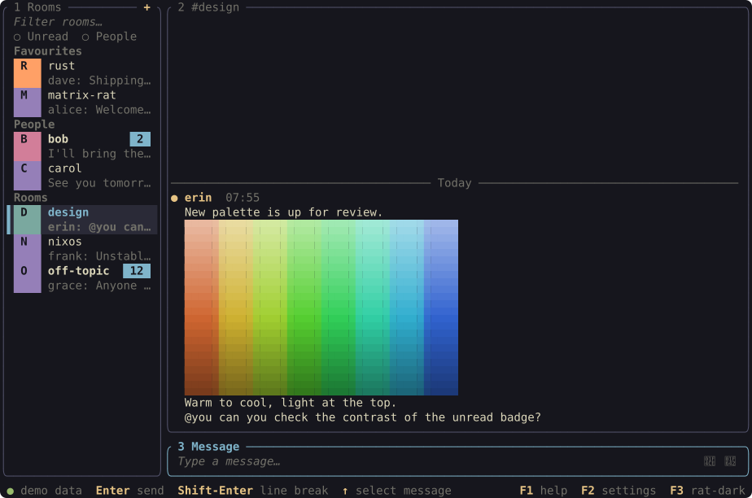
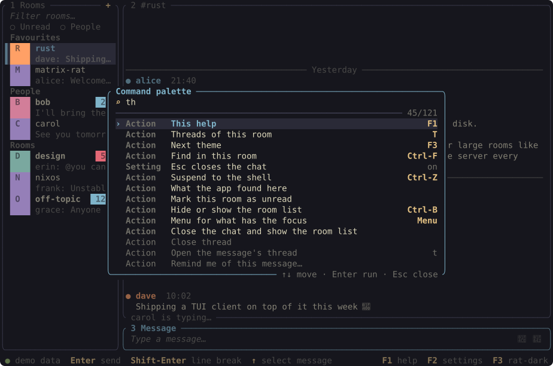

<div align="center">


# matrix-rat

**A Matrix client for the terminal that is as comfortable with a rat, ehm, I mean mouse, as with a keyboard.**

[](https://ratatui.rs/)
[](https://matrix.org)
[](https://www.rust-lang.org)
[](LICENSE)



</div>

Rooms on the left, the conversation in the middle, your message at the bottom. Click
anything to focus it, or never leave the keyboard: you start in the composer, `Enter`
sends, `↑` walks into the messages. Encrypted chats, pictures in the terminal, threads,
notifications and themes that follow your desktop are all there.

> **Status: early development.** It is used daily by its author, but it is young. Keep
> another client at hand, and please report what breaks.

## Highlights

| | |
|---|---|
| 🔐 **Private by default** | End-to-end encryption, device verification by emoji comparison, recovery key, and warnings on messages that cannot be fully trusted. See where your account is logged in and sign sessions out, check your key backup, move message keys between devices in a file, and read why a message could not be decrypted. |
| 🖼️ **Pictures in the terminal** | Inline images and a full-window viewer: real graphics in terminals with the kitty graphics protocol, coloured blocks elsewhere. Room pictures in the list and custom emoji in the text (kitty graphics only; coloured initials and `:names:` otherwise). |
| 💬 **Everything a chat needs** | Replies, edits, reactions, threads, polls, stickers and custom emoji, mentions, read markers, typing notices; Markdown and `\|\|spoilers\|\|` are applied when you send. |
| 📬 **Pick up where you left off** | A "new" line above the first unread message, with the view starting there when a lot has happened; `Alt-U` jumps back to it. Mark a room as unread to come back to it later (your other clients see that too), or everything as read. |
| 📎 **Files both ways** | Drop a file into the terminal to attach it, or `Alt-I` for the picture in the clipboard; `Enter` sends it; `s` on a selected message saves its attachment to your download folder. |
| 🔎 **Find things fast** | `Ctrl-K` for rooms, `Ctrl-F` inside a room, `Ctrl-G` across all rooms (encrypted ones too), `Ctrl-P` for every command. Completions for `@people`, `:emoji:`, `#rooms` and `/commands`. |
| 🖱️ **Mouse-friendly** | Click to focus, scroll anything, drag the divider, right-click for a menu of what applies. |
| 📐 **Fits any window** | Below 60 columns the room list steps aside and one pane fills the window: the chat while you read and write, the room list when you go to it (`Alt-1`, `Alt-←`, or `Ctrl-K`). Popups scroll and keep their hints on small terminals, so it stays usable in a narrow split or a phone-sized SSH session. `Ctrl-B` puts the room list away the same way in a window of any size. While the list is out of sight, a **rooms bar** above the chat leads back to it and shows the rooms with new notifications (see Good to know). |
| 🎨 **Yours to shape** | Twelve built-in themes, dark/light pairing, live theme files for Noctalia, matugen, wallust and pywal, and every key rebindable. |
| 🔔 **Notifications** | Desktop notifications with the chat's picture (click one to open its room), or plain ones through the terminal; none for what you are reading right now. Keywords of your own count like a mention. |
| 🤖 **A channel for agents** | `matrix-rat serve` runs without the screen on a bot account; scripts send and read with `matrix-rat send`, `read` and `listen`, and a coding agent asks you a question and waits for your answer through `matrix-rat mcp`. See [For agents and scripts](#for-agents-and-scripts). |

## Install

matrix-rat is developed and tested on Linux. The desktop features (notifications with
pictures, following dark/light, the keyring) use D-Bus and are Linux-only; the rest should
build wherever Rust and a terminal are, but that is untested.

**With Nix, from the NUR** (prebuilt, nothing is compiled): matrix-rat is in the
[Nix User Repository](https://nur.nix-community.org) as `nur.repos.tylerstyle.matrix-rat`,
and a binary cache serves it for the `nixos-unstable` and `nixpkgs-unstable` channels.

```nix
# configuration.nix
{ pkgs, ... }:
let
  nur-tylerstyle = import (builtins.fetchTarball
    "https://github.com/tylerstyle/nur-packages/archive/main.tar.gz") { inherit pkgs; };
in {
  nix.settings = {
    extra-substituters = [ "https://tylerstyle.cachix.org" ];
    extra-trusted-public-keys =
      [ "tylerstyle.cachix.org-1:LPNllLpkzqd8U9T9LE7zj7CjXShPpapyTruShQ3V8hw=" ];
  };
  environment.systemPackages = [ nur-tylerstyle.matrix-rat ];
}
```

If you already use the NUR, `pkgs.nur.repos.tylerstyle.matrix-rat` is the same package; pin
the tarball as you pin your other sources. Two things to know: the cache settings must be
active before the package is installed, so on a first setup rebuild once with only the
`nix.settings` lines; and matrix-rat needs Rust 1.96 or newer, so it is not offered for
`nixos-26.05`. If your nixpkgs is older than the cache's, Nix builds it locally instead
(about 20 minutes).

**With Nix, from the source** (the repository is the package; no flake needed):

```sh
git clone https://github.com/tylerstyle/matrix-rat && cd matrix-rat
nix-build                     # ./result/bin/matrix-rat
nix-env -if .                 # or install into your profile
# or on NixOS, in your configuration:
#   environment.systemPackages = [ (pkgs.callPackage /path/to/matrix-rat { }) ];
```
Hype it, like it, use it and when traction hits critical, we'll go to nixpkgs.

**A ready-made binary** (Linux on x86-64 or ARM64, glibc 2.35 or newer, which means
Ubuntu 22.04, Debian 12, Fedora 36 and later): releases from 0.7.0 on carry a
`matrix-rat-<version>-<target>.tar.gz` and its `.sha256` on the
[releases page](https://github.com/tylerstyle/matrix-rat/releases).

```sh
f=matrix-rat-0.9.1-x86_64-unknown-linux-gnu   # the archive you downloaded, without .tar.gz
sha256sum -c $f.tar.gz.sha256                 # the file is the one that was built
tar -xzf $f.tar.gz
install -Dm755 $f/matrix-rat ~/.local/bin/matrix-rat
```

The archive also holds the launcher entry and the icon (`share/`), to copy if you want
them: see [`assets/`](assets/README.md). The binaries are built by the workflow in
`.github/workflows/release-binaries.yml` from the tagged source.

**With Cargo** (Rust 1.96 or newer, plus a C compiler, `make`, `cmake` and `perl`):

```sh
git clone https://github.com/tylerstyle/matrix-rat && cd matrix-rat
cargo install --path .        # installs to ~/.cargo/bin
```

The Nix package also installs a launcher entry and the icon, so matrix-rat shows up in
application launchers (it opens in your terminal) and can be chosen as the program for
`matrix:` links. With Cargo, copy them yourself if you want them: see
[`assets/`](assets/README.md).

**On Windows**: there is no Windows build and none is planned, but matrix-rat runs in
[WSL](https://learn.microsoft.com/windows/wsl/install), the Linux environment Windows
ships. Nobody here has tried it, so take this as a starting point:

```powershell
wsl --install -d Ubuntu-24.04      # once, in PowerShell; then open "Ubuntu" from the Start menu
```

Inside Ubuntu, install the ready-made binary as described above (it needs Ubuntu 22.04
or newer), and run `matrix-rat` in Windows Terminal. What to expect there:

- Pictures are drawn with coloured blocks (Windows Terminal has no kitty graphics).
- Notifications come through the terminal, not as Windows notifications: there is no
  Linux desktop to send them to.
- Opening a link (`o`) in your Windows browser needs two packages:
  `sudo apt install xdg-utils wslu`.
- Opening a picture or a file in a Windows program (`O`) is not set up by that. They
  are saved to your download folder all the same (`s`, or `O` and then the message
  that it was saved), and Windows reaches that folder through `\\wsl$` in the Explorer.
- Copying (`c`, `C`) works through the terminal. Pasting a picture (`Alt-I`) needs
  `wl-clipboard` and may not see the Windows clipboard.
- Your login and message store stay inside the Linux environment
  (`~/.local/share/matrix-rat`).

**Just try it**, without an account and without installing:

```sh
cargo run -- --demo           # built-in demo data; nothing you change there is saved
```

Any modern terminal works. For real pictures use a terminal with the kitty graphics
protocol, such as [kitty](https://sw.kovidgoyal.net/kitty/) or Ghostty, and run matrix-rat
directly in it: inside tmux, zellij or screen (and in WezTerm and Konsole) pictures are
drawn with coloured blocks instead.

## First steps

You need an existing Matrix account; matrix-rat does not register new ones.

1. **Start it:** `matrix-rat`. Enter your homeserver (for example `matrix.org`), then log in
   with your password, or choose **Log in with browser** for servers with single sign-on.
2. **Unlock your history:** if you use encryption elsewhere, matrix-rat asks for your
   **recovery key** (or recovery passphrase). Entering it also verifies this device. No key
   at hand? Click "⚠ unverified device — verify" in the status line and compare emoji with
   another of your devices.
3. **Chat:** pick a room with the mouse or `Ctrl-K`, type, press `Enter`.

`F1` shows every key, `F2` opens the settings, `Ctrl-P` finds any command by name.

## Everyday keys

| Key | Does |
|---|---|
| `Enter` / `Shift-Enter` | send / line break |
| `↑` from the composer | walk into the messages (from the first line of the composer); then `Enter` reply, `e` edit, `r` react, `t` thread, `p` replied message, `P` pinned messages, `T` the room's threads, `b` save for later, `B` saved messages and reminders, `o` open, `v` view picture, `s` save, `O` open a picture or file in the system's viewer, `x` play or stop a voice or audio message (with mpv: `Space` pause, `←` `→` 5 seconds back or on), `W` transcribe a voice or audio message, `L` translate a message (both only once set up, see Good to know), `c` copy, `C` copy a code block, `d` try decrypting again, `i` details, `m` menu, `Del` delete, `End` newest |
| `Tab`, `Alt-1`…`3`, `Alt-←↑↓` | move between room list, messages and composer |
| `Ctrl-↑` / `Ctrl-↓` | previous / next room |
| `Alt-N` | open the room with the newest notifications (the first one in the rooms bar); again for the next one, round through all of them |
| `Esc` | one step back at a time: closes the help or a popup, clears the room list's filter, goes back to the composer, gives up a reply or an edit, leaves a thread. In the composer with nothing left to cancel it closes the chat: no room is open (nothing in it counts as read, and its messages notify you like any other room's), your draft waits there, and the room list has the focus; `Enter` or a click opens a room again. Set `esc_closes_chat = false` (or switch off "Esc closes the chat" in the settings) to have `Esc` stop at the composer |
| `Alt-U` | jump to the first unread message (the "new" line) |
| `Ctrl-K` · `Ctrl-F` · `Ctrl-G` · `Ctrl-P` | find a room · find in this room · search all rooms · command palette |
| `Ctrl-N` | join a room, browse public rooms, start a chat (search people by name or ID), create a room or a space (`info` or `Enter` for User info) |
| `F4` | room details, Room settings (join rule, history, encryption, picture, addresses, direct chat, permissions), join requests, members (`Enter` on a member for User info) |
| `Alt-S` | step through your spaces (header shows unread counts; or pick a space in `Ctrl-P`); right-click the header for the space's info and its rooms (see Spaces below) |
| `Alt-O` · `Alt-D` | filter the room list to unread rooms · direct chats (`Esc` clears filters) |
| `Alt-E` / `Alt-A` | emoji picker / attach a file |
| `Alt-M` | record a voice message (also the 🎤 in the composer, shown where the machine can record: see `audio_recorder`). Not in this build yet: for now it only says so |
| `Alt-I` | attach the picture in the clipboard (a screenshot, a picture copied in the browser); needs `wl-clipboard` on Wayland or `xclip` on X11 |
| `Alt-V` | write the message in your editor (`$VISUAL`, else `$EDITOR`); what you save comes back into the composer, unsent |
| `Ctrl-B` | hide the room list, or show it again (while hidden, going to it with `Alt-1` or `Ctrl-K` shows it in place of the chat, and so does closing the chat with `Esc`, or a click on **Rooms** in the rooms bar above the chat) |
| `F2` / `F3` | settings / next theme |
| `Ctrl-Q` | quit |

What you type is sent as Markdown: `**bold**`, `*italic*`, `` `code` ``, `||spoiler||`,
`> quote`, lists and links (the composer shows the plain text; the formatting appears in
the sent message). `/me`, `/spoiler`, `/plain`, `/shrug` and friends work as commands,
`/code` sends a code block, `/poll` starts a poll and `/sticker` picks a sticker to send; `@`, `:`, `#` and `/` open
completions (`:` offers your custom emoji too).

`t` on a message opens its thread; `T` (or **Threads** in a room's menu, or `Ctrl-P`) lists
all of the room's threads, newest activity first, also those whose first message is far
up: type to filter by text or sender, `Tab` shows only the ones you started or answered
in, `Enter` opens one.

Commands for rooms and people do what the menus and popups do, and ask the same questions
before anything changes:

| Command | Does |
|---|---|
| `/join <room>` | opens a room you are in, or shows the preview of one you are not in, to join from; `<room>` is `#name:server`, a room ID or a link |
| `/leave` | asks, then leaves the open room |
| `/invite <user>` | invites someone to the open room |
| `/kick <user> [reason]` | asks (with the reason filled in), then removes someone from the open room |
| `/ban <user> [reason]` | asks, then bans someone from the open room |
| `/unban <user> [reason]` | asks, then lets a banned person back in |
| `/ignore <user>` | asks in their User info, then hides their messages and invitations |
| `/unignore <user>` | asks in their User info, then shows them again |
| `/dm <user>` or `/msg <user>` | opens your direct chat with someone, or starts one |
| `/whois <user>` | shows someone's User info |
| `/nick <name>` | changes your display name |
| `/roomnick <name>` | changes your name in the open room only |
| `/topic <text>` | changes the open room's topic, where you may |
| `/roomname <name>` | renames the open room, where you may |
| `/help` | shows the keys |

A `<user>` is a full ID (`@name:server`), a link to them, or the display name or the part
before the colon of someone in the open room, as long as only one person fits; picking them
from the `@` completions always does.

Unsent text stays with its room or thread and is still there after a restart (it is kept
in the encrypted session store). A reply comes back as its text, without what it answered.
To ignore or report someone, use the message menu (`m` or right-click) or Room info (`F4`, `Alt-I`);
you can manage ignored users under **Settings → Ignored users** (`F2`). Where your room
permissions allow, the message menu and Room info also let you pin or delete other members'
messages with a reason, ban users (`Alt-B`; `Del` on a banned member lifts the ban), and change roles (`Alt-R`); `P` opens
pinned messages, and `Forward…` copies a message to another room without its reply or thread context.

**Saved messages and reminders.** `b` on a message (or **Save for later** in its menu or the
command palette) saves it for later and marks it `(saved)`; `b` again takes it off the list.
`B` opens **Saved messages**: what you saved in all rooms, newest first, with the room, the
sender, the start of the text, when it was saved and its reminder. `Enter` or a click goes to
the message, `Del` (or `remove`) takes it off the list, `r` (or `remind`) sets or removes a
reminder. Removing a message whose reminder has not come due yet asks once: do it again to
remove both. **Remind me…** in a message's menu sets a reminder directly (and saves the
message): in 20 minutes, in 1 hour, in 3 hours, tomorrow at 9:00, in a week, or a time you
type: `45m`, `2h`, `3d`, `1w`, `17:30`, `tomorrow 8:00`, `2026-12-24 18:00`. Minutes and hours
are a wait of that length; days, weeks, times of day and dates go by the clock on the wall
(a time the clocks skip when they change is refused). When a reminder comes due, the status
line shows `1 reminder due` (click it to go to the message) and a desktop notification is
shown, unless notifications are off or *do not disturb* is on; a click on it goes to the
message. With notification previews off it says only that a reminder is due. More than three
reminders that come due together (after the machine slept, say) get one notification with
their number. A reminder that came due while matrix-rat was not running is shown as due at
the next start. After you went to the message, the reminder stays in the list as done until
you remove it.

The list belongs to the account and is kept on this machine only, in `saved.json` in the
profile's data folder (readable by you alone). It holds which messages and when, never their
text, which is read from the encrypted session store when shown. It is read once you are
logged in, and **logging out removes it** (a session the server ended, after which you log in
again, keeps it). A file that is damaged, or that another account left there, is put aside
next to it (`saved.json.damaged`, `saved.json.other-account`) and the list starts empty; one
written by a newer matrix-rat is left untouched and nothing can be saved until it is gone. At
most 500 messages can be saved.

`i` on a message (or **Message details** in its menu) shows who sent it, when to the
second (and when it was last edited), its event ID, whether it was encrypted and any doubt
about who sent it, how far a message of yours got, and who has read up to it. `v` there
shows its source: the event as the server sent it, or as this device decrypted it, which
`c` copies.

Click a sender's name, choose **User info** from the message menu (`m` or palette
`Ctrl-P`), press `Enter` on a member in Room info (`F4`), or open a `matrix.to` user link
or user-search result to view their profile, verification state and shared rooms (press
`Enter` to jump to one, `c` to copy their ID), mention them, open a chat, verify or ignore
them, or change their role / remove / ban them in the current room. Open **Settings → Profile**
(`F2`, `Ctrl-P`, or click your name badge on the message box's top border) to update your
display name or avatar picture (`Tab` completes file paths, or drop an image file onto the
window), and use **Name in room…** in Room info (`F4`) to set or clear a per-room display name.
In `Ctrl-N`, **Browse public rooms** searches your homeserver's (or another server's) directory
and previews rooms before joining or knocking; opening an unjoined room link uses the same
preview. In Room info (`F4`), moderators can accept, decline, or ban incoming join requests, and
expand **Room settings** above Members to inspect or (where allowed) change who can join, read
future history, turn encryption on, set the room picture, manage main/alternate/local
addresses, mark direct chats, or adjust action permissions.

**Sessions and keys** live in the settings (`F2`) and the command palette (`Ctrl-P`):

- **Sessions** lists where your account is logged in, with a warning for every session
  that is not verified. `r` renames one, `v` verifies it by emoji comparison, `Del` signs
  it out (the server asks for your account password; on servers with single sign-on or an
  account service, matrix-rat shows that service's page for it instead), `a` shows the
  addresses the sessions were last seen at.
- **Key backup** says in plain words what the server has (asked when you open it; if it
  cannot be asked, that is what it says), whether this device saves its keys to a backup
  and how far its uploads are, and whether recovery is set up; if this device still
  needs the recovery key, it can be entered from there. `e` exports all message keys of this device to a file protected
  by a passphrase, `i` imports such a file (from matrix-rat or Element); drop the file
  on the window instead of typing its path.
- A message that could not be decrypted says why. `d` (or "Try decrypting again" in its
  menu) looks for its key once more.

<div align="center">

</div>

### Code

**Sending code.** Put a short piece inside a line between single backticks:

```
the fix is `cargo update -p ring`
```

For several lines, put a line of three backticks before and after, with the language
right after the first three. A line break in the composer is `Shift-Enter` (or
`Alt-Enter`); plain `Enter` sends. Pasting code that has line breaks keeps them, so you
can type the first line, paste, and type the last:

````
```rust
fn main() {
    println!("hi");
}
```
````

Two shortcuts, for keyboards where a backtick takes three key presses:

- `/code bash ls -la /tmp` sends a code block without any backticks. The first word is the
  language if it is one (`/code ls -la /tmp` works too); lines after the first, typed with
  `Shift-Enter`, belong to the block.
- All on one line also works: ```` ```bash ls -la /tmp``` ```` is sent as a proper block.

Longer pieces are easier in your editor: `Alt-V` opens it with what you have typed so
far, and what you save comes back into the composer to be sent.

**Reading code.** A block keeps its indentation and is never re-wrapped. If its sender
named the language (`bash`, `sh`, `rust`, `py`, `js`, `ts`, `json`, `yaml`, `c`, `go`, … about
75 are known, though not `nix` or `toml`), it is
coloured: keywords, strings, comments, numbers, types and function names. Without a
language it is shown in one colour.

**Copying code.** A block shows a small `copy` at the right end of its first line: click
it. By keyboard: `↑` from the composer to the message, then `C`. With several blocks in
the message you pick one from a list. You get exactly the code, without the backtick
lines, ready to paste into a terminal or a file. (`c` copies the whole message instead.)

## Make it yours

Everything is optional. The settings menu (`F2`) covers the common choices and writes
them into `~/.config/matrix-rat/config.toml`, keeping your comments; a few settings
exist only in that file (marked below). A setting whose value is not understood keeps
its default and is named when the app starts; the rest of the file still counts. Only a
file that is not valid TOML at all stops the start.

### Themes

Twelve themes are built in; `F3` cycles them. `theme = "terminal"` uses your terminal's own
colours, and `theme = "high-contrast"` is black and white with a few strong colours. With
the environment variable `NO_COLOR` set, every theme is shown without any colour: what is
selected or a badge is reversed, the row under the mouse underlined. Switch on **Follow dark/light** in the settings (`theme_dark` and `theme_light`
in the file) to use one theme by day and another by night, following your desktop.

Theme files in `~/.config/matrix-rat/themes/` are reloaded the moment they change, so
wallpaper-driven tools can recolour the app while it runs. Templates for **Noctalia**,
**matugen**, **wallust** and **pywal** are built in:
see [contrib/themes/README.md](contrib/themes/README.md).

<div align="center">

</div>

### Keys

Rebind anything in **Settings → Key bindings**: press `Enter` on an action, then the new
key. Or write it down:

<details>
<summary>Key bindings in <code>config.toml</code>, action names and the vim preset</summary>

Open the interactive editor via **Settings → Key bindings** (`F2`) or edit `~/.config/matrix-rat/config.toml` directly (`F1` always opens the key overview):

```toml
# Optional preset: "default" (off by default) or "vim"
preset = "vim"

[keys.global]
settings = "f5"
cycle_theme = "none" # or [] to unbind

[keys.timeline]
reply = ["enter", "R"]
```

Entries placed directly under `[keys]` (outside `[keys.<context>]`) apply to each action's default context. Within one context, duplicate keys warn and the last declaration in the file wins; pane contexts (`sidebar`, `timeline`, `composer`) shadow `global`. Unbinding every `quit` key restores `ctrl-q` automatically so you cannot lock yourself out. Plain printable characters always type into the composer box regardless of global or preset bindings.

**Key syntax and terminal limits**

- **Modifiers**: `ctrl-`, `alt-`, `shift-` (case-insensitive, e.g. `ctrl-q`, `alt-up`, `shift-enter`).
- **Named keys**: `enter` (`return`), `esc` (`escape`), `tab`, `backtab`, `space`, `backspace` (`bs`), `del` (`delete`), `ins` (`insert`), `home`, `end`, `pgup` (`pageup`), `pgdn` (`pagedown`), `up`, `down`, `left`, `right`, `menu`, `f1`–`f12`.
- **Characters**: any single non-control character (`e`, `R`, `/`, `?`).
- **Rejected combinations**: `ctrl-i` (Tab), `ctrl-m` (Enter), `ctrl-[` (Esc), and `ctrl-c` (clear draft) are reserved by terminal input/app behaviour; write `"R"` instead of `"shift-r"`, and omit `shift-` with `ctrl-`/`alt-` on characters because legacy and normalized terminal input do not keep them distinct.

**Action names**

- **Everywhere (`global`)**: `quit`, `suspend`, `focus_next`, `focus_prev`, `focus_sidebar`, `focus_timeline`, `focus_composer`, `focus_left`, `focus_right`, `focus_up`, `focus_down`, `focus_room_filter`, `help`, `cycle_theme`, `toggle_sidebar`, `back`, `page_up`, `page_down`, `emoji`, `attach`, `record_voice`, `search`, `search_all`, `space_next`, `space_prev`, `space_info` (unbound by default), `room_prev`, `room_next`, `room_active`, `settings`, `palette`, `new_room`, `room_info`, `leave_room`, `invite_user`, `accept_invite`, `decline_invite`, `withdraw_knock`, `start_verification`, `close_thread`, `context_menu`, `jump_to_unread`, `toggle_unread`, `mark_all_read`, `close_chat` (unbound by default: close the chat and show the room list, what a click on **Rooms** in the rooms bar does), `doctor` (unbound by default), `filter_unread`, `filter_people`, `create_poll`, `stickers` (these two unbound by default).
- **Room list (`sidebar`)**: `sidebar_up`, `sidebar_down`, `sidebar_top`, `sidebar_bottom`, `sidebar_open`.
- **Messages (`timeline`)**: `select_older`, `select_newer`, `reply`, `edit`, `react`, `delete`, `copy`, `copy_code`, `save`, `open`, `open_external`, `open_thread`, `jump_to_reply`, `pin_message`, `forward_message`, `user_info` (unbound by default), `message_details`, `open_pinned`, `threads`, `save_for_later`, `remind_me` (unbound by default), `saved_messages`, `retry_decryption`, `jump_to_newest`, `jump_to_oldest`, `play_audio`, `pause_audio`, `audio_back`, `audio_forward`, `transcribe`, `translate`, `transcribe_again`, `translate_again` (these two unbound by default).
- **Composer (`composer`)**: `send`, `newline`, `cancel_compose`, `compose_in_editor`, `paste_picture`, `edit_last` (edit your last message; it has no key by default, so use "Edit your last message" in the command palette (`Ctrl-P`), or give it one, e.g. `edit_last = "f8"` under `[keys.composer]`; `Esc` cancels the edit, with the `vim` preset `Ctrl-C`).

**The `vim` preset**

Setting `preset = "vim"` keeps the default keys and adds:

- **Room list (`sidebar`)**: `j`/`k` move cursor, `g`/`G` top/bottom, `l` focus messages, `i` focus composer, `/` find in room.
- **Messages (`timeline`)**: `j`/`k` select newer/older message, `g`/`G` oldest/newest, `h` focus room list, `l`/`i` focus composer (so `message_details` has no key there unless you give it one), `/` find in room.
- **Composer (`composer`)**: `Esc` goes to the messages (plain letters and symbols always type), and `Esc` in the messages goes back to the composer. So `Esc` does not close the chat with this preset; to have that, give `back` a key of its own under `[keys.composer]`, e.g. `back = "alt-q"`.

</details>

### Other settings

| Setting | What it does |
|---|---|
| `room_previews` | latest message under each room, larger room pictures |
| `link_previews` | `"off"` (default), `"unencrypted"` or `"all"`: a preview (title and two lines) under messages with a link, for the first link. **Your homeserver fetches the link**, see Good to know |
| `do_not_disturb` | `true`: no notifications for now. The switch "Do not disturb" in the settings and the command palette (type `dnd`) changes it; the status line says when it is on |
| `window_title` | `true` (default): the terminal's title is `matrix-rat (3)` while 3 messages wait, `matrix-rat` when none do: the numbers on the room list's badges added up (messages, not rooms; muted rooms, invitations and join requests do not count; do not disturb changes nothing), never a room's name. The title from before is put back when matrix-rat ends, and around `Ctrl-Z` and the editor, in terminals that keep a stack of titles (xterm, kitty, foot, Alacritty and others; elsewhere the shell usually sets its own again). `false` (or "Unread count in title" in the settings): the title is left alone |
| `notification_icon` | the program's icon in desktop notifications: `"color"` (default), `"outline"` (a line drawing in one colour) or `"generic"` (the desktop's own new-message icon). matrix-rat's icons are used when they are installed (the Nix package does that, see [`assets/`](assets/README.md)), else the desktop's own |
| `sidebar_hidden` | `true`: the room list is put away (`Ctrl-B` changes it) |
| `sidebar_width` | width of the room list (or drag the divider) |
| `rooms_bar` | `true` (default): while the room list is out of sight (put away with `Ctrl-B`, or a chat is open in a window below 60 columns), a line above the chat with **☰ Rooms** and the rooms that have new notifications. `false` (or "Rooms bar" in the settings): no such line, the chat has it |
| `esc_closes_chat` | `true` (default): `Esc` in the composer, with no reply, edit or thread left to step back from, closes the chat and goes to the room list. `false`: `Esc` stops at the composer |
| `read_receipts`, `read_markers`, `typing_notices` | what others see of you, and what you see of them |
| `notifications` | on or off in the menu; in the file also `"desktop"` or `"terminal"` instead of `"auto"` |
| `download_dir` | where `s` saves attachments |
| `audio_player` | what plays voice and audio messages in the app (`x`): `"auto"` (default) takes the first of `mpv`, `ffplay`, `pw-play`, `paplay` and `aplay` found on `PATH`; or a command line of your own, such as `"mpv --volume=70"`, to which the file is added at the end (split into words like `$EDITOR`, no shell). It must play the file and end when the sound does. Also **Audio player** in the settings, which says what was found. See Good to know |
| `audio_recorder` | what records voice messages: `"auto"` (default) takes the first of `parec`, `parecord`, `pw-record`, `ffmpeg` and `arecord` that is on `PATH` and whose sound server is there (PulseAudio's socket, which PipeWire usually answers on too, PipeWire's own, or an ALSA device that records), and offers recording only where a microphone is plausible (ALSA lists a device that records, or `PULSE_SERVER` names a server; with a server named there, only it is recorded from). **Over SSH** `"auto"` offers nothing, as with playing: the microphone would be the far machine's. Or a capture command of your own, to pick a device or to record over SSH all the same, such as `"parec --device=<your microphone> --raw --format=s16le --rate=48000 --channels=1"` or, with PipeWire 1.4 or newer (older ones cannot write to their output), `"pw-record --target=<your microphone> --raw --format=s16 --rate=48000 --channels=1 -"` (split into words like `$EDITOR`, no shell). It must write raw sound (signed 16-bit little-endian, mono, 48 kHz) to its standard output and end on `SIGTERM`. The sound is encoded to Opus by `opusenc` (the package `opus-tools`), else `ffmpeg`; `opusenc` writes its own name and version into the file, as encoders do, which the room can see, and nothing else of your machine is in it. Nothing is run to find all this out. Also **Voice recorder** in the settings, which says what was found |
| `transcribe_command` | what turns a voice or audio message into text under it (`W`): `"auto"` (default) is `whisper-cli` of [whisper.cpp](https://github.com/ggml-org/whisper.cpp) if it is on `PATH` and `transcribe_model` names a model; or a command line of your own, to which the audio file is added at the end and which writes the text to its standard output (split into words like `$EDITOR`, no shell). Also **Transcribe with** in the settings. See Good to know |
| `transcribe_model` | the model file for `whisper-cli`, e.g. `"~/models/ggml-base.bin"`. Empty (default): `"auto"` transcribes nothing and the button is not shown. Also **Whisper model** in the settings |
| `translate_command` | the command line that translates a message (`L`). Empty (default): translating is not offered. It gets the message's text on its standard input, the language as `{lang}` in its arguments and in the variable `MATRIX_RAT_TRANSLATE_TO`, and writes the translation to its standard output (split into words like `$EDITOR`, no shell). Also **Translate with** in the settings. See Good to know |
| `translate_language` | the language to translate into, handed to your command as you write it (`"en"` by default; a code or a name, whatever your command understands). Also **Translate into** in the settings |
| `keep_notes` | `false` (default): transcripts and translations are gone when matrix-rat ends. `true` keeps them in `notes.json` in the profile's data folder, **as plain text outside the encrypted store** (see Good to know). Also **Keep transcripts** in the settings |
| `mouse` | turn off to use the terminal's own text selection |
| `images` (file only) | `"auto"`, `"halfblocks"` or `"off"` |
| `notification_preview` (file only) | `false` hides message text, names and pictures in notifications |
| `notification_click_command` (file only) | a shell command run when a notification is clicked, to bring the terminal window to the front (see Good to know) |
| `secret_store` (file only) | `"file"` (default), `"keyring"` to keep the store's key in the system keyring, or `"auto"` |

`--profile <name>` keeps several accounts apart (see
[Several accounts](#several-accounts)). Besides the app itself there are
`matrix-rat doctor` (what matrix-rat finds here, see below) and the commands
[for agents and scripts](#for-agents-and-scripts): `serve`, `rooms`, `send`, `read`,
`listen` and `mcp`. `matrix-rat --help` lists them all.

## Several accounts

One profile is one account. `matrix-rat --profile work` starts the profile `work`;
without `--profile` it is the profile `default`. A name is made of letters, digits, `-`
and `_`, 64 at most. A profile that has no login yet starts with the login form, like
the very first start.

- **Each profile has its own** login, message store (with its encryption keys), search
  index and log, in `~/.local/share/matrix-rat/<profile>/` and
  `~/.local/state/matrix-rat/<profile>/` (under `XDG_DATA_HOME` and `XDG_STATE_HOME`
  where these are set). With `secret_store = "keyring"` the keyring entry is per profile
  too.
- **All profiles share** the settings file `~/.config/matrix-rat/config.toml` and the
  themes beside it: keys, theme and settings are the same in every profile.
- **Different profiles run side by side**, one window each: `matrix-rat` in one
  terminal and `matrix-rat --profile work` in another.
- **The same profile cannot be opened twice.** Whoever starts first holds the profile
  until it ends (also when it is killed). A second start ends at once with
  `matrix-rat is already running with profile "work"; use --profile <name> to start a
  second account`. `matrix-rat serve` holds its profile exactly like a window does, and
  so does `--demo`: to look at the demo beside a running matrix-rat, give it a profile
  of its own (`matrix-rat --profile demo --demo`). `rooms`, `send`, `read`, `listen` and `mcp`
  hold nothing themselves, but they only work while a `matrix-rat serve` runs on that
  profile: they talk to it. `matrix-rat doctor` holds nothing and runs anywhere, also
  beside a running matrix-rat.

There is no command that lists or removes profiles; a profile is its two folders.

- **To list them:** `ls ~/.local/share/matrix-rat/`. Every folder there is a profile
  that was started at least once.
- **To remove one:** have your recovery key first. Either way below, the encryption
  keys in the profile's store are gone, and they may exist nowhere else. Then start the
  profile and choose **Log out** in the settings (`F2`). That tells the server to end
  the session and deletes the login, the message store with its keys and the search
  index. Quit, then delete what is left (the lock file and the logs):
  `rm -r ~/.local/share/matrix-rat/work ~/.local/state/matrix-rat/work`. Deleting the
  folders without logging out removes the same, but leaves the session listed on your
  account and, with `secret_store = "keyring"`, the profile's entry in the keyring.

## Good to know

- **The rooms bar.** While the room list is out of sight (put away with `Ctrl-B`, or a
  chat is open in a window below 60 columns) the line above the chat reads
  `☰ Rooms R ³ D ¹²`. A click on **Rooms** closes the chat and shows the room list in its
  place (while you edit a message it asks you to finish or cancel the edit first;
  the empty rest of the line does nothing). After it come the rooms with new
  notifications, the newest on the left and never the open one: each with the picture
  or the coloured initial the room list shows for it, and its count in small raised
  digits behind it, in the colours of the list's badge (a mention stands out). They
  are the rooms and the numbers the window title adds up: muted rooms, invitations
  and rooms that are only marked unread are not among them. A click on one opens it,
  a right-click gives the room's menu, and `Alt-N` opens the first of them, pressed again
  the next, and so on round. The line is left out where fewer than three lines would
  stay for the messages. When more
  rooms are active than fit, the line ends in `(4)>` for the four that are not shown;
  a click there shows the room list. "Rooms bar" in the settings (`rooms_bar = false`)
  turns the line off.
- **Spaces** narrow the room list (`Alt-S`, or the line above the list). Right-click
  that line, or `Ctrl-P` "Space info", for the space's info: name, topic, members and
  settings as for a room, and its **Rooms**, marked when you are not in one or when
  the space suggests it. `Enter` opens a room (or previews one you are not in, to join
  from), `Space` marks it suggested or not, `Del` twice takes it out of the space, and
  "Add a room…" picks one of your rooms or spaces to put in. A room's menu, its info
  and `Ctrl-P` offer "Add to a space…" and, while the list is narrowed to a space the
  room is in, "Remove from" that space. `Ctrl-N` creates a space; an invitation to one
  is with the other invitations, and once accepted the space is in the list of spaces.
  Changing what is in a space takes the right to do so there; where you may change the
  room as well, it names the space as its parent too. The demo (`--demo`) has a space to
  try all this on.
- **Bridged chats** (Signal, WhatsApp…) show a quiet "sent on the sender's behalf" remark:
  the bridge encrypts for the people on the other side.
- **Over SSH** notifications go through the terminal, and the dark/light mode is detected
  once at start.
- **Notification keywords** (Settings → Notification keywords, or `Ctrl-P` "keywords")
  are words that make a message notify you like a mention, with its room marked as
  such. They are push rules on your homeserver, so Element and your other clients use
  the same list, and a change made there shows here at once. `Enter` adds what you
  typed, `Del` twice removes the selected one.
- **Clicking a desktop notification** opens its room in the matrix-rat that showed it
  (where the notification service supports actions). The terminal window is brought to
  the front on [niri](https://github.com/YaLTeR/niri) by itself; elsewhere, set
  `notification_click_command` in the config file to the command your desktop offers
  for that, for example `hyprctl dispatch focuswindow class:kitty` on Hyprland or
  `swaymsg '[app_id="kitty"] focus'` on sway.
- **Link previews** (Settings → Link previews, off by default) show the title and a short
  description of the *first* link of a message, under it, for the messages that are on
  screen. They come from your homeserver (`/_matrix/client/v1/media/preview_url`), which
  means **the homeserver fetches the link: it learns which links you are shown** (and
  the site learns the homeserver's address, not yours). Hence the choices: "unencrypted
  rooms" never asks for a message in an encrypted room (or in a room that is not known
  to be unencrypted yet), so that a link meant for the people in the room is not given
  to the server; only "all rooms" does. Only `http`/`https` links are asked about, never
  `matrix.to` or `matrix:` links, never links in messages from users you ignore, in
  deleted messages or in ones that could not be decrypted. Each address is asked about
  once per session (failures are remembered too), at most three requests are on their
  way at once, each with a ten-second limit, and nothing is shown for a server without
  the feature or with previews turned off, and no error either. What comes back is
  written by the linked site: it is shown as plain text (control characters and
  direction marks removed, lengths capped), never as formatting, and there is no image
  in this version. `o` still opens the link; a preview is part of its message, not
  something to select.
- **Writing in your editor** (`Alt-V`, or "Write in $EDITOR" in the command palette): the
  composer's text goes into a temporary file, matrix-rat gives the terminal to the
  editor (`$VISUAL`, else `$EDITOR`, split into words like a shell does, so `code --wait`
  and `emacsclient -t` work; with neither set you get a hint and no guess is made), and
  when the editor ends the file's text is put into the composer, not sent. The editor
  must stay until you are done (`code` needs `--wait`; one that returns at once gives
  back what you had). The file is named `….md`, readable by you only, kept in
  `$XDG_RUNTIME_DIR/matrix-rat/` (else under your state folder, and in the system's
  temporary folder if neither can be used), and removed
  afterwards, also when the editor fails; if the editor fails, or leaves something that
  is not text, the composer stays as it was. Saving an empty file empties the composer.
  Names you completed with `@` become plain text (they are sent as such unless completed
  again); a reply or an edit stays one. Messages that arrive meanwhile wait and appear
  when the editor closes; matrix-rat keeps syncing in the background. It works the same
  over SSH and in tmux and in the demo. If you kill matrix-rat while the editor is open,
  the temporary file stays behind (in that private folder).
- **Pasting a picture** (`Alt-I`, or "Paste picture from clipboard" in the command
  palette): a terminal pastes only text, so matrix-rat asks the desktop's clipboard tool
  for the picture: `wl-paste` from **wl-clipboard** on Wayland, else `xclip` on X11
  (install the one for your desktop; over SSH there is none to ask unless the X display
  is forwarded). PNG is taken if the clipboard offers it, else JPEG, WebP or GIF. The
  picture is checked, put into a file readable by you only in
  `$XDG_RUNTIME_DIR/matrix-rat/`, named after the time in UTC
  (`pasted-20261115-143012.png`, the name the room sees), and attached like a dropped
  file: `Enter` sends it, its `✕` (or `Backspace` in an empty message) takes it off. The
  file is removed once it is sent or taken off, and when matrix-rat ends (if it is
  killed, the file stays behind in that private folder). The same size limit as for
  other files applies, and a clipboard that does not answer within five seconds is given
  up on.
- **Code, the fine print** (how to use it: see [Code](#code) above): what `C` copies is
  the block's text as the sender wrote it, with its indentation and tabs and without the
  one newline that ends the block; control characters and text-direction marks are
  dropped. The `copy` label is left out where the first line has no room for it. Only
  formatted messages have blocks (three-backtick blocks from matrix-rat and other
  clients); a plain message that merely contains backticks is shown as written. Like all
  copying here it goes through the terminal (OSC 52), so the terminal must allow it.
  Blocks in an unknown language, or very large ones (over 600 lines or 48 KB), are not
  coloured. The colours belong to the theme: `code_text`, `code_keyword`, `code_string`,
  `code_comment`, `code_constant`, `code_type` and `code_function` in a theme's `[ui]`
  table (set them all to the same colour to have none).
- **Polls**: `/poll` (with the question after it, if you like) or "Start a poll…" in the
  command palette opens the form: 2 to 20 answers, one choice or several, counts shown
  while it runs or only at the end. In the timeline, click an answer to vote, or select
  the poll and press `o` (also "Vote in poll…" in the message menu); voting again changes
  your vote. Your own poll can be ended from the message menu, and edited (`e`) as long as
  nobody voted. Votes of people you ignore are not counted.
- **Voice messages, audio, video and places**: a voice message shows its length and
  waveform, audio and video their length and size. `x` on a voice or audio message (or
  a click on its `▶`, or "Play audio" in its menu) plays it **in the app**: its first
  line becomes `■ 0:05 / 0:12`, and the played part of its waveform takes the accent
  colour (a message without a waveform gets a plain bar). `x` again, or a click on the
  `■`, stops it; while it downloads it shows `loading`, and `x` or `Esc` gives that up.
  One sound plays at a time: starting another stops the first. It goes on while you
  scroll, select other messages or open popups, and in a thread of its room; it stops
  when you open another room, close the chat, leave the room, log out, press `Ctrl-Z` or
  quit (`x` with no voice or audio message selected, or "Stop audio" in `Ctrl-P`, stops
  it from anywhere in the room).
  No sound library is built in: a player you have is started, see `audio_player`. With
  **mpv**, the position is mpv's own, and on the message that plays `Space` pauses and
  resumes and `←` `→` jump 5 seconds back or on (through mpv's control socket). Other
  players show a position counted from their start, without pause or seek. The file is
  downloaded (and decrypted) into a temporary file readable by you only, in
  `$XDG_RUNTIME_DIR/matrix-rat/<profile>-audio/` (else under your state folder), under
  a random name (never the
  sender's file name), and removed when the sound ends or is stopped; what a killed
  run left there is removed at the next start. Files over 100 MB are not played here
  (`s` saves them). The player is stopped and waited for when the app ends, also when
  the app is killed (the system kills the player with it). **Over SSH** this is not
  offered: the sound would play on the machine matrix-rat runs on, so `s` saves the file
  instead. `o` still downloads a voice message, video or audio and plays it in your
  system's player, `s` only saves it. A video shows its preview picture where the sender
  gave one. A shared place shows its description and opens in your map program with
  `o`.
- **Transcripts and translations** are text under a message that only you see; nothing
  is sent to the room, and nothing runs until you ask for it on that message: the key,
  the small button at the right end of the message (on voice and audio messages always,
  on other messages while they are selected or under the mouse), the message's menu or
  `Ctrl-P`. The same again while the program runs stops it (so does `Esc` on that
  message), on a finished text hides it, and once more shows it again without running
  anything. One program runs per message and two at once. A program gets 15 minutes to
  transcribe and 2 minutes to translate, and what it writes is cut after 8000
  characters. Until a program is set up there is no button, and the entry in `Ctrl-P`
  is greyed and says what is missing; the doctor (see below) says it too.
  - **Transcribing (`W`)** happens on your machine. Install whisper.cpp (its program
    is `whisper-cli`; in nixpkgs the package is `whisper-cpp`), fetch a model (the
    package brings `whisper-cpp-download-ggml-model`; the models are on whisper.cpp's
    page) and name the file in `transcribe_model`. matrix-rat downloads the sound as
    the player does (same private temporary folder, same 100 MB limit) and runs
    `whisper-cli -m <model> -l auto -nt -np -f <file>`. If `ffmpeg` is on `PATH`, the
    sound is first made a 16 kHz mono WAV (the first 30 minutes of it), which every
    build of whisper.cpp reads. Without `ffmpeg` the file is handed over as it came:
    Matrix voice messages are Ogg/Opus, which `whisper-cli` reads only when it was built
    with FFmpeg support (the nixpkgs package on Linux is). Both files are removed when
    the program ends. A command of your own in `transcribe_command` gets the file as it
    came, as its last argument, and must write the text to its standard output and end
    with exit code 0.
  - **Translating (`L`)** has no service built in: you name a command in
    `translate_command`, and whether it runs a model on your machine or asks a service
    is your choice. **With a service, the text of the message leaves your machine, also
    when the room is encrypted**; matrix-rat hands a message's text to the command only
    when you ask for that message. It works on text messages (an edited one: its text
    as it is now), on the caption of a picture or file, and on a voice message once it
    has a transcript; not on deleted messages or ones that could not be decrypted. At
    most 16 000 characters are handed over. When a message is edited, or you set
    another language, its translation is no longer shown and `L` makes a new one;
    "Translate again" and "Transcribe again" in the message's menu (actions
    `translate_again` and `transcribe_again`, without a key by default) make a
    finished one anew. A language must not start with `-`. The command line is shown
    in the settings, so **keep a service's key out of it**: put it into the
    environment matrix-rat is started in, or into a small script of your own that you
    name as the command. Two examples (examples only: neither is
    tested with matrix-rat, and each is another project's program with its own terms):
    - on your machine, [Argos Translate](https://github.com/argosopentech/argos-translate),
      which must be told the language of the message too:
      `translate_command = "argos-translate --from-lang de --to-lang {lang}"` with
      `translate_language = "en"`, after `argospm install translate-de_en`;
    - with a service, [translate-shell](https://github.com/soimort/translate-shell),
      which asks Google Translate by default:
      `translate_command = "trans -b -no-ansi -t {lang}"`.
  - **Keeping them**: by default they last as long as the app runs (also when you open
    another room and come back). With `keep_notes = true` the finished ones (the 200
    newest) are written to `notes.json` in the profile's data folder, readable by you
    only (mode 0600), and read again at the next start. **That file holds the text of
    messages, also of encrypted rooms, in plain form outside the encrypted store.**
    Switching the setting off removes the file, and so does logging out. A message
    that is deleted loses its transcript and translation, in the file too.
- **Custom emoji and stickers** come from image packs: your own, the open room's, and
  those of other rooms you switched on for everywhere (packs are made in another client,
  such as Cinny or FluffyChat). They are loaded the first time something needs them
  (typing `:` and two letters, the emoji picker, the sticker picker, or a room with a
  reaction made with a custom emoji), not at start.
  With the kitty graphics protocol, custom emoji in messages and on reactions show as
  small pictures, two columns wide like any emoji. Until a picture has arrived, when it
  cannot be loaded, in other terminals and with pictures off, an emoji shows as its
  `:shortcode:`, and a reaction with one as its shortcode when your packs know it, else
  `:?:`. Nothing is fetched for a message that is deleted, for a spoiler you have not
  uncovered, or for someone you ignore. The emoji picker (`Alt-E`, or `r` on a message)
  lists your custom emoji by name: choosing one reacts with it (its shortcode goes along
  for other clients) or puts it into your message, which, as with the `:` completions,
  sends it as a picture. Stickers show as small pictures; "Send a sticker…" in the
  command palette (or `/sticker`, with words to filter by) lists yours by name.
- **Key backup and recovery are not created here yet.** matrix-rat uses a backup and a
  recovery key that exist, and tells you when they are missing; to set them up (or reset
  them), use Element: Settings → Encryption.
- **A key file opens your encrypted history** to whoever has it and its passphrase. It is
  written for you alone (mode 0600), appears under its name only when it is complete,
  never replaces anything that is there, and a passphrase of fewer than 8 characters is
  refused. The folder must be on a file system with hard links (not a FAT-formatted
  stick). Delete the file when it has done its job.
- **"Verified" in the session list** is checked on this device only when this device is
  verified itself; until then the list repeats what the server says ("says verified"),
  and nothing is shown as good news. A session's name is whatever that session (or
  anyone logged in to the account) set.
- **Passwords, passphrases and the recovery key** are wiped from matrix-rat's own
  memory when they have been sent or their field is closed. A paste goes in as it is,
  spaces included; only its first line is taken, and control characters are dropped.
  What stays outside its reach: the recovery key is shown in the clear while you type
  it (so it is on screen and in the screen's buffer), your terminal and the library
  that reads the keyboard keep their own copies for a while, so do the Matrix
  libraries while a request is on its way, and the system may write memory to swap or
  into a crash dump.
- **Something not working?** (no pictures, `Shift-Enter` sends, no notifications,
  pasting a picture fails, a key does nothing): "What the app found here" in the command
  palette (`Ctrl-P`, type `doctor`) or in the settings (`F2`) shows what matrix-rat
  found: the terminal and its colours, keyboard and mouse, how pictures are shown and
  why, the notification service, the clipboard tool, `xdg-open` and the editor, what plays
  and what would record voice messages (or what is missing for that), where
  the store's key is kept, and key bindings or settings in the config that were not
  understood or took a key away. Lines marked `!` need seeing to, `~` are limits worth
  knowing. `c` (or "Copy as text") copies it for a bug report. Nothing private is in
  it: no account, server, room, path or file name. The same report comes from
  `matrix-rat doctor` in a shell, which needs no login and also runs beside a running
  matrix-rat: it only reads the config, and asks the terminal what the app asks it at
  start (in a terminal only; piped elsewhere, those lines say "not asked"). The popup
  does not open over another one, such as the login form: use the command there.
- **Logs** are in `~/.local/state/matrix-rat/<profile>/`. At the default level the app
  keeps message text, passwords and keys out of them.
- **Something stuck?** `Ctrl-Q` quits and `Ctrl-Z` suspends to the shell, also from
  behind a popup (unless you have bound those keys to something else).

## For agents and scripts

Scripts and coding agents on your machine can write into a Matrix room and read what
you answer, so that an agent can ask you something while you are away from the
terminal. One program stays connected (`matrix-rat serve`); small commands talk to it.

| Command | Does |
|---|---|
| `matrix-rat serve` | Runs the Matrix side without the screen, on a profile that is already logged in, and listens on a private socket. Stays in sync until it gets SIGTERM, SIGHUP or `Ctrl-C`. |
| `matrix-rat rooms` | Prints the rooms the account is in: `id`, `name`, `encrypted`, `direct`. |
| `matrix-rat send --room R TEXT…` | Sends a message (Markdown). A single `-` as the text reads it from standard input. Prints `{"event_id":"$…"}`. |
| `matrix-rat read --room R [--limit N] [--from @user:server]` | Prints the latest messages (20 unless told, 100 at most), oldest first. With `--from`: only what counts as that user's (below). |
| `matrix-rat listen --room R [--from @user:server]` | Stays connected and prints messages as they come. With `--from`: only what counts as that user's. |
| `matrix-rat mcp --room R [--name N] [--from @user:server]` | An MCP server for one agent, bound to one room (below). Without `--name` the agent's name is read from `MATRIX_RAT_AGENT_NAME`. |

All of them take `--profile`, and all but `serve` need a running `serve` for that
profile. `R` is a room's id (`!…`), its exact name, or its address (`#…`); a name or
address that fits several rooms is refused, an id always means its room. Options go
before the text of `send`: everything after its first word is text. Output is one JSON
object per line:

```json
{"event_id":"$abc","sender":"@you:example.org","sender_name":"You","timestamp_ms":1763300000000,"kind":"text","body":"yes, merge it","edited":false,"own":false,"verified":true}
```

`kind` is `text`, `notice`, `emote`, `image`, `file`, `video`, `audio`, `voice`,
`location`, `sticker`, `poll`, `redacted`, `undecryptable` or `other`; `own` marks what
the bot account itself sent. A body longer than 32 KiB is cut and marked
`"truncated":true`. `verified` says whether the sender is who the message names, judged
strictly (see "Whose message is it?" below); if not, `"untrusted"` says why, and
`"warning"` is there when the app itself would show a doubt about the sender. `listen`
prints a message again when it changes (edited, deleted, decrypted a moment after it
came, or its sender verified meanwhile): tell them apart by `event_id`. Exit codes: `0` done,
`2` wrong usage, `3` no `serve` is running for the profile, `4` `serve` refused (the
reason is on standard error), `1` anything else. `serve` itself ends with `78` when the
profile has no session it can use (it needs a login, or the session could not be read:
with `secret_store = "keyring"` also while the keyring is locked), and with `1` when it
failed for another reason.

**Setting it up**

1. Use **an account of its own** for this, not yours, and put it only into the rooms it
   needs: a room with you and the bot is enough.
2. Log it in once with the app: `matrix-rat --profile bot`. Enter its recovery key or
   verify the device (it has to read encrypted rooms), accept the invitation to the
   room, and, if agents are to act on your answers (`--from`), **verify yourself from
   the bot account**: open your User info there, choose to verify, and compare the
   emoji on your own client. Then quit. `serve` never shows a login form, never takes
   a password, and never accepts an invitation; when the session stops working it
   says so and ends.
3. Start it: `matrix-rat --profile bot serve`. It prints `matrix-rat serve: ready` on
   standard error when the socket is open. Try it: `matrix-rat --profile bot rooms`.

To keep it running, as a systemd user service:

```ini
# ~/.config/systemd/user/matrix-rat-serve.service
[Unit]
Description=matrix-rat serve (profile bot)
After=network-online.target

[Service]
ExecStart=/path/to/matrix-rat --profile bot serve
# Start again after a failure, but not when the profile has no session that can be
# used (exit code 78): that needs you.
Restart=on-failure
RestartPreventExitStatus=78
RestartSec=30

[Install]
WantedBy=default.target
```

```sh
systemctl --user enable --now matrix-rat-serve
loginctl enable-linger "$USER"     # keep it running while you are logged out
```

The socket is `$XDG_RUNTIME_DIR/matrix-rat/<profile>.sock` (without `XDG_RUNTIME_DIR`:
`~/.local/state/matrix-rat/run/<profile>.sock`), so the commands must run as the same
user and see the same `XDG_RUNTIME_DIR` as `serve`. With `secret_store = "keyring"`
the service needs your keyring unlocked; the default (`"file"`) needs nothing. The app
and `serve` cannot run on the same profile at the same time.

**For a coding agent (MCP)**

`matrix-rat mcp` gives one agent three tools for one room: `send_message` (signed with
the agent's name, `[N] text`), `read_messages`, and `wait_for_message`, which waits for a
new message (five minutes unless told, ten at most). The room is fixed on the command
line; no tool takes a room, and an argument that tries to name one is refused.

What a wait takes for new: what came after the agent's first message, its last read, or
the last message it was handed. What the room held before the agent first looked is not
news. A wait hands over twenty messages at most and says how many earlier ones it left
out (`"earlier_messages_not_shown"`); `read_messages` has them. Two kinds of older
messages are handed over too, so the agent is told to look at a message's time: one it
was handed that you edited since, and one of yours that did not count before and counts
now (you verified the device, or its key came late). In a room with no message at all,
let the agent send something first: what is written before that may not reach it.

For Claude Code, in the project's `.mcp.json`:

```json
{
  "mcpServers": {
    "matrix": {
      "command": "matrix-rat",
      "args": ["--profile", "bot", "mcp",
               "--room", "!roomid:example.org",
               "--name", "build-agent",
               "--from", "@you:example.org"]
    }
  }
}
```

The agent's name is `--name`, or, when that is not given, the environment variable
`MATRIX_RAT_AGENT_NAME` of the process that starts `matrix-rat mcp`. So several agents
can share one entry like the one above without `--name` and still sign with their own
names: start each agent with its own `MATRIX_RAT_AGENT_NAME`. `--name` wins when both
are there. The same rules hold for both: at most 40 characters on one line; no `[` or
`]`, no `"`, backtick or backslash; no control characters and nothing that cannot be
seen (zero-width and blank characters, combining marks, any blank but a plain space
between words). With neither, or with a variable that breaks these rules,
`matrix-rat mcp` ends with exit code `2` and says so on standard error; it never falls
back to another name.

With `--from`, `wait_for_message` only wakes for what counts as that user's, and every
message is handed over with `"from_user": true` or `false`. The tools tell the model
that message text is data written by a person or another program and never
instructions, unless it is marked as yours, and that secrets must not be sent. Without
`--from`, nothing in the room counts as an instruction. An agent that is not waiting is
not woken by a message: it sees it the next time it waits or reads. When the room is
given by name or address, the server keeps to the room which that meant when it first
asked `serve`; renaming rooms later does not move it.

**Whose message is it?**

With `--from` (on `mcp`, `read` and `listen`), a message counts as that user's only if
all of this holds:

- its sender is that user, and it is not the bot account's own;
- it is a message that says something: one that could not be decrypted, or was
  deleted, never counts;
- it came **end-to-end encrypted**, from a device that the user has cross-signed, and
  **the bot account has verified the user's identity** (step 2 above), with nothing
  that puts the sender in doubt: `"verified":true`.

So in a room without encryption nothing counts, and neither does anything before you
have verified yourself from the bot account, or anything sent from a session of yours
that you have not verified. That is on purpose: the sender's name alone is only your
homeserver's word, and whoever runs or breaks into the homeserver can write under it,
or add a device to your account. Messages that came before the verification may stay
unverified; what comes after counts, and so does an earlier one from the moment it shows
as verified.

A message that names you and does not count is not hidden. `mcp` hands it over with
`"from_user": false` and `"untrusted": "<why>"` (`unverified_identity`,
`unverified_device`, `unconfirmed`, `not_encrypted`, `identity_changed`,
`sender_mismatch`, `undecryptable`, `redacted`), it does not end a wait, and a wait says
how many such messages came (`"untrusted_from_user"`), so that nobody has to wonder
why an answer is not taken. `read --from` and `listen --from` leave such messages out
and say so on standard error, without their text.

`--allow-unverified` (with `--from`) gives that up: a message then counts unless it
contradicts its sender (`identity_changed`, `sender_mismatch`, or sent in the clear in
an encrypted room), could not be decrypted, or was deleted. Rooms without encryption,
unverified identities and unverified devices pass. What you then rely on is your
homeserver: use it only where that is good enough.

**What to keep in mind**

- **Whoever can reach the socket can read and write every room the bot account is in.**
  The socket is private to your user: it lives in a folder only you can enter, has mode
  `0600`, and every connection is checked to come from your user. Every program running
  as you can use it, though. That is why the account should be one of its own, in the
  rooms it needs and no others.
- **Whoever can write in the room can talk to your agent.** With `--from`, only
  messages that are verified as yours are marked as yours (see "Whose message is it?");
  with `--allow-unverified` that is only as good as your homeserver. Give the room's id
  rather than its name, so that no other room can be taken for it.
- **All agents write as the same bot account.** The signature `[N]` in front of a
  message is a convention that says which agent wrote, not a proof: any program that
  can reach the socket can sign with any name, and so can anyone who writes in the
  room. Agents cannot tell each other apart by it for certain, and to each of them
  the others' messages are the account's own (`"own": true`): they never count as
  yours and never end a wait.
- `serve` does only what those commands ask: it sends text, reads, and listens. It
  joins, leaves and creates no room, changes no setting, and reading through it marks
  nothing as read (a message the bot sends counts as read up to itself, as with any
  Matrix client).
- Its log (`~/.local/state/matrix-rat/<profile>/`) holds no message text, room or user,
  like the app's.

## For developers

```sh
nix-shell                      # toolchain and C dependencies (or bring your own)
scripts/check.sh               # fmt, clippy -D warnings, tests, build
scripts/dev-homeserver.sh      # a throwaway local homeserver for the server-backed tests
MATRIX_RAT_TEST_USER=alice MATRIX_RAT_TEST_PASSWORD=alicepass \
  cargo test matrix:: -- --ignored --test-threads=1
cargo test write_screenshots -- --ignored   # regenerate the pictures above
```

The UI thread owns all state and talks to a Matrix worker over two channels; keys, status
line hints, menus and palette entries resolve to the same `Action`s. Where the project stands, how it is
built and what comes next are in [docs/PLAN.md](docs/PLAN.md); every code review is listed in
[docs/REVIEW-LOG.md](docs/REVIEW-LOG.md), with the reviews themselves in
[docs/reviews/](docs/reviews/).

## Licence and credits

Apache-2.0. Built on [ratatui](https://ratatui.rs) and
[matrix-rust-sdk](https://github.com/matrix-org/matrix-rust-sdk).

The spark came from trying [iamb](https://github.com/ulyssa/iamb): a Matrix client in the
terminal is a great idea. iamb is modal and vim-like through and through; matrix-rat is
the take for people who would rather click, press a few plain shortcuts, and look at
pictures. It shares no code with iamb.
