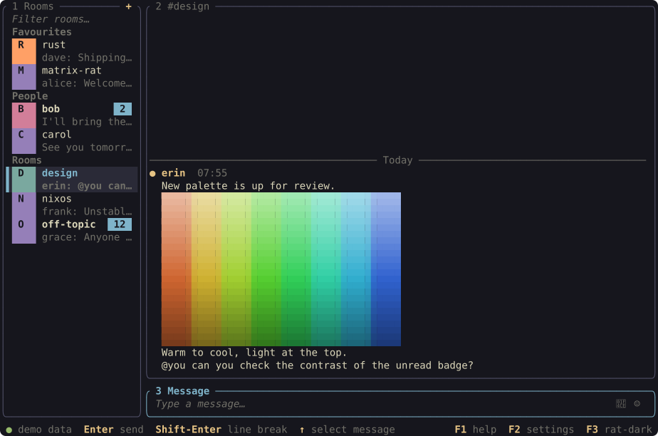
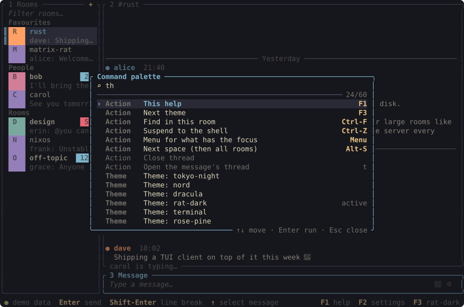
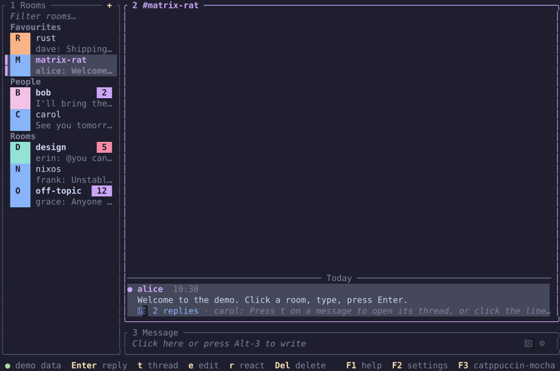

<div align="center">

# 🐀 matrix-rat

**A Matrix client for the terminal that is as comfortable with a rat, ehm, I mean mouse, as with a keyboard.**

[](https://ratatui.rs/)
[](https://matrix.org)
[](https://www.rust-lang.org)
[](LICENSE)



</div>

Rooms on the left, the conversation in the middle, your message at the bottom. Click
anything to focus it, or never leave the keyboard: you start in the composer, `Enter`
sends, `↑` walks into the messages. Encrypted chats, pictures in the terminal, threads,
notifications and themes that follow your desktop are all there.

> **Status: early development.** It is used daily by its author, but it is young. Keep
> another client at hand, and please report what breaks.

## Highlights

| | |
|---|---|
| 🔐 **Private by default** | End-to-end encryption, device verification by emoji comparison, recovery key, and warnings on messages that cannot be fully trusted. |
| 🖼️ **Pictures in the terminal** | Inline images and a full-window viewer: real graphics in terminals with the kitty graphics protocol, coloured blocks elsewhere. Room pictures in the list (kitty graphics only; coloured initials otherwise). |
| 💬 **Everything a chat needs** | Replies, edits, reactions, threads, mentions, read markers, typing notices; Markdown and `\|\|spoilers\|\|` are applied when you send. |
| 📎 **Files both ways** | Drop a file into the terminal to attach it, `Enter` sends it; `s` on a selected message saves its attachment to your download folder. |
| 🔎 **Find things fast** | `Ctrl-K` for rooms, `Ctrl-F` inside a room, `Ctrl-P` for every command. Completions for `@people`, `:emoji:`, `#rooms` and `/commands`. |
| 🖱️ **Mouse-friendly** | Click to focus, scroll anything, drag the divider, right-click for a menu of what applies. |
| 🎨 **Yours to shape** | Eleven built-in themes, dark/light pairing, live theme files for Noctalia, matugen, wallust and pywal, and every key rebindable. |
| 🔔 **Notifications** | Desktop notifications with the chat's picture, or plain ones through the terminal; none for what you are reading right now. |

## Install

matrix-rat is developed and tested on Linux. The desktop features (notifications with
pictures, following dark/light, the keyring) use D-Bus and are Linux-only; the rest should
build wherever Rust and a terminal are, but that is untested.

**With Nix** (the repository is the package; no flake needed):

```sh
git clone https://github.com/tylerstyle/matrix-rat && cd matrix-rat
nix-build                     # ./result/bin/matrix-rat
nix-env -if .                 # or install into your profile
# or on NixOS, in your configuration:
#   environment.systemPackages = [ (pkgs.callPackage /path/to/matrix-rat { }) ];
```
Hype it, like it, use it and when traction hits critical, we'll go to nixpkgs.

**With Cargo** (Rust 1.96 or newer, plus a C compiler, `make`, `cmake` and `perl`):

```sh
git clone https://github.com/tylerstyle/matrix-rat && cd matrix-rat
cargo install --path .        # installs to ~/.cargo/bin
```

**Just try it**, without an account and without installing:

```sh
cargo run -- --demo           # built-in demo data; nothing you change there is saved
```

Any modern terminal works. For real pictures use a terminal with the kitty graphics
protocol, such as [kitty](https://sw.kovidgoyal.net/kitty/) or Ghostty, and run matrix-rat
directly in it: inside tmux, zellij or screen (and in WezTerm and Konsole) pictures are
drawn with coloured blocks instead.

## First steps

You need an existing Matrix account; matrix-rat does not register new ones.

1. **Start it:** `matrix-rat`. Enter your homeserver (for example `matrix.org`), then log in
   with your password, or choose **Log in with browser** for servers with single sign-on.
2. **Unlock your history:** if you use encryption elsewhere, matrix-rat asks for your
   **recovery key** (or recovery passphrase). Entering it also verifies this device. No key
   at hand? Click "⚠ unverified device — verify" in the status line and compare emoji with
   another of your devices.
3. **Chat:** pick a room with the mouse or `Ctrl-K`, type, press `Enter`.

`F1` shows every key, `F2` opens the settings, `Ctrl-P` finds any command by name.

## Everyday keys

| Key | Does |
|---|---|
| `Enter` / `Shift-Enter` | send / line break |
| `↑` from the composer | walk into the messages (from the first line of a draft); then `Enter` reply, `e` edit, `r` react, `t` thread, `o` open, `v` view picture, `s` save, `c` copy, `m` menu, `Del` delete, `End` newest |
| `Tab`, `Alt-1`…`3`, `Alt-←↑↓` | move between room list, messages and composer |
| `Ctrl-↑` / `Ctrl-↓` | previous / next room |
| `Ctrl-K` · `Ctrl-F` · `Ctrl-G` · `Ctrl-P` | find a room · find in this room · search all rooms · command palette |
| `Ctrl-N` | join a room, start a chat, create a room |
| `F4` | room details and members (invite, rename, notifications, favourite, leave) |
| `Alt-S` | step through your spaces |
| `Alt-E` / `Alt-A` | emoji picker / attach a file |
| `F2` / `F3` | settings / next theme |
| `Ctrl-Q` | quit |

What you type is sent as Markdown: `**bold**`, `*italic*`, `` `code` ``, `||spoiler||`,
`> quote`, lists and links (the composer shows the plain text; the formatting appears in
the sent message). `/me`, `/spoiler`, `/plain`, `/shrug` and friends work as commands;
`@`, `:`, `#` and `/` open completions.

<div align="center">

</div>

## Make it yours

Everything is optional. The settings menu (`F2`) covers the common choices and writes
them into `~/.config/matrix-rat/config.toml`, keeping your comments; a few settings
exist only in that file (marked below).

### Themes

Eleven themes are built in; `F3` cycles them. `theme = "terminal"` uses your terminal's own
colours. Switch on **Follow dark/light** in the settings (`theme_dark` and `theme_light`
in the file) to use one theme by day and another by night, following your desktop.

Theme files in `~/.config/matrix-rat/themes/` are reloaded the moment they change, so
wallpaper-driven tools can recolour the app while it runs. Templates for **Noctalia**,
**matugen**, **wallust** and **pywal** are built in:
see [contrib/themes/README.md](contrib/themes/README.md).

<div align="center">

</div>

### Keys

Rebind anything in **Settings → Key bindings**: press `Enter` on an action, then the new
key. Or write it down:

<details>
<summary>Key bindings in <code>config.toml</code>, action names and the vim preset</summary>

Open the interactive editor via **Settings → Key bindings** (`F2`) or edit `~/.config/matrix-rat/config.toml` directly (`F1` always opens the key overview):

```toml
# Optional preset: "default" (off by default) or "vim"
preset = "vim"

[keys.global]
settings = "f5"
cycle_theme = "none" # or [] to unbind

[keys.timeline]
reply = ["enter", "R"]
```

Entries placed directly under `[keys]` (outside `[keys.<context>]`) apply to each action's default context. Within one context, duplicate keys warn and the last declaration in the file wins; pane contexts (`sidebar`, `timeline`, `composer`) shadow `global`. Unbinding every `quit` key restores `ctrl-q` automatically so you cannot lock yourself out. Plain printable characters always type into the composer box regardless of global or preset bindings.

**Key syntax and terminal limits**

- **Modifiers**: `ctrl-`, `alt-`, `shift-` (case-insensitive, e.g. `ctrl-q`, `alt-up`, `shift-enter`).
- **Named keys**: `enter` (`return`), `esc` (`escape`), `tab`, `backtab`, `space`, `backspace` (`bs`), `del` (`delete`), `ins` (`insert`), `home`, `end`, `pgup` (`pageup`), `pgdn` (`pagedown`), `up`, `down`, `left`, `right`, `menu`, `f1`–`f12`.
- **Characters**: any single non-control character (`e`, `R`, `/`, `?`).
- **Rejected combinations**: `ctrl-i` (Tab), `ctrl-m` (Enter), `ctrl-[` (Esc), and `ctrl-c` (clear draft) are reserved by terminal input/app behaviour; write `"R"` instead of `"shift-r"`, and omit `shift-` with `ctrl-`/`alt-` on characters because legacy and normalized terminal input do not keep them distinct.

**Action names**

- **Everywhere (`global`)**: `quit`, `suspend`, `focus_next`, `focus_prev`, `focus_sidebar`, `focus_timeline`, `focus_composer`, `focus_left`, `focus_right`, `focus_up`, `focus_down`, `focus_room_filter`, `help`, `cycle_theme`, `back`, `page_up`, `page_down`, `emoji`, `attach`, `search`, `search_all`, `space_next`, `space_prev`, `room_prev`, `room_next`, `settings`, `palette`, `new_room`, `room_info`, `leave_room`, `invite_user`, `accept_invite`, `decline_invite`, `start_verification`, `close_thread`, `context_menu`.
- **Room list (`sidebar`)**: `sidebar_up`, `sidebar_down`, `sidebar_top`, `sidebar_bottom`, `sidebar_open`.
- **Messages (`timeline`)**: `select_older`, `select_newer`, `reply`, `edit`, `react`, `delete`, `copy`, `save`, `open`, `open_thread`, `jump_to_newest`, `jump_to_oldest`.
- **Composer (`composer`)**: `send`, `newline`, `cancel_compose`.

**The `vim` preset**

Setting `preset = "vim"` keeps the default keys and adds:

- **Room list (`sidebar`)**: `j`/`k` move cursor, `g`/`G` top/bottom, `l` focus messages, `i` focus composer, `/` find in room.
- **Messages (`timeline`)**: `j`/`k` select newer/older message, `g`/`G` oldest/newest, `h` focus room list, `l`/`i` focus composer, `/` find in room.
- **Composer (`composer`)**: `Esc` returns focus to messages (plain letters and symbols always type).

</details>

### Other settings

| Setting | What it does |
|---|---|
| `room_previews` | latest message under each room, larger room pictures |
| `sidebar_width` | width of the room list (or drag the divider) |
| `read_receipts`, `read_markers`, `typing_notices` | what others see of you, and what you see of them |
| `notifications` | on or off in the menu; in the file also `"desktop"` or `"terminal"` instead of `"auto"` |
| `download_dir` | where `s` saves attachments |
| `mouse` | turn off to use the terminal's own text selection |
| `images` (file only) | `"auto"`, `"halfblocks"` or `"off"` |
| `notification_preview` (file only) | `false` hides message text, names and pictures in notifications |
| `secret_store` (file only) | `"file"` (default), `"keyring"` to keep the store's key in the system keyring, or `"auto"` |

`--profile <name>` keeps several accounts apart.

## Good to know

- **Bridged chats** (Signal, WhatsApp…) show a quiet "sent on the sender's behalf" remark:
  the bridge encrypts for the people on the other side.
- **Over SSH** notifications go through the terminal, and the dark/light mode is detected
  once at start.
- **Logs** are in `~/.local/state/matrix-rat/<profile>/`. At the default level the app
  keeps message text, passwords and keys out of them.
- **Something stuck?** `Ctrl-Q` quits and `Ctrl-Z` suspends to the shell, also from
  behind a popup (unless you have bound those keys to something else).

## For developers

```sh
nix-shell                      # toolchain and C dependencies (or bring your own)
scripts/check.sh               # fmt, clippy -D warnings, tests, build
scripts/dev-homeserver.sh      # a throwaway local homeserver for the server-backed tests
MATRIX_RAT_TEST_USER=alice MATRIX_RAT_TEST_PASSWORD=alicepass \
  cargo test matrix:: -- --ignored --test-threads=1
cargo test write_screenshots -- --ignored   # regenerate the pictures above
```

The UI thread owns all state and talks to a Matrix worker over two channels; keys, status
line hints, menus and palette entries resolve to the same `Action`s. The design, the milestones and the
log of every code review are in [docs/PLAN.md](docs/PLAN.md); the reviews themselves are in
[docs/reviews/](docs/reviews/).

## Licence and credits

Apache-2.0. Built on [ratatui](https://ratatui.rs) and
[matrix-rust-sdk](https://github.com/matrix-org/matrix-rust-sdk).

The spark came from trying [iamb](https://github.com/ulyssa/iamb): a Matrix client in the
terminal is a great idea. iamb is modal and vim-like through and through; matrix-rat is
the take for people who would rather click, press a few plain shortcuts, and look at
pictures. It shares no code with iamb.
